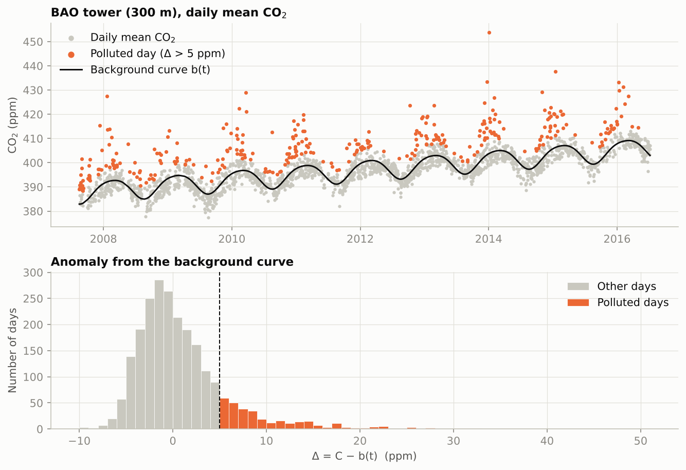
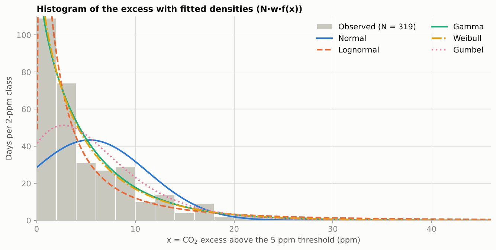
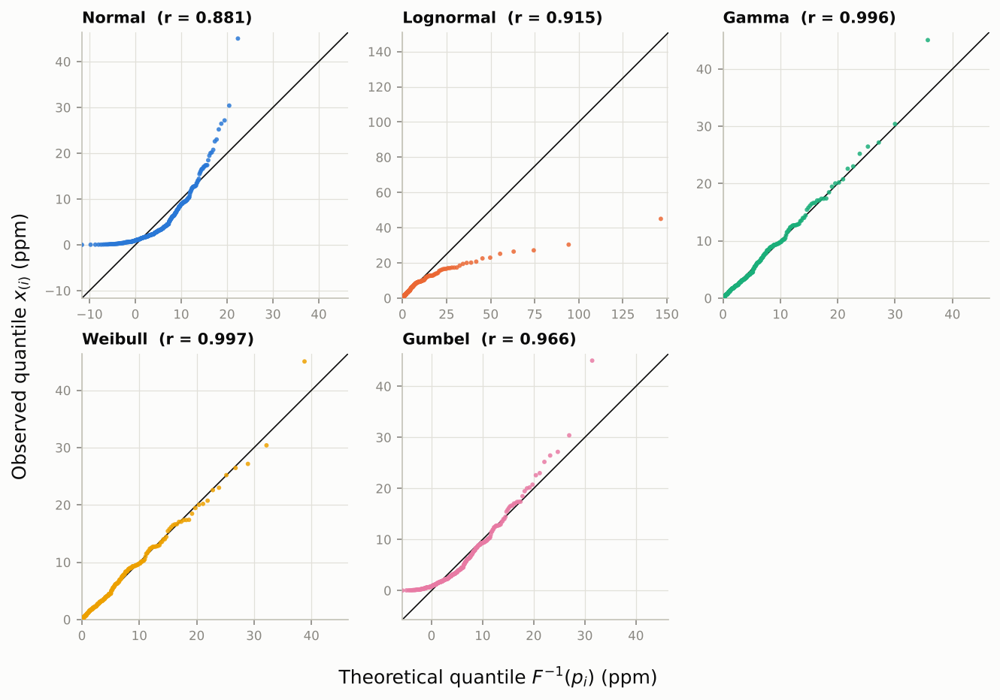
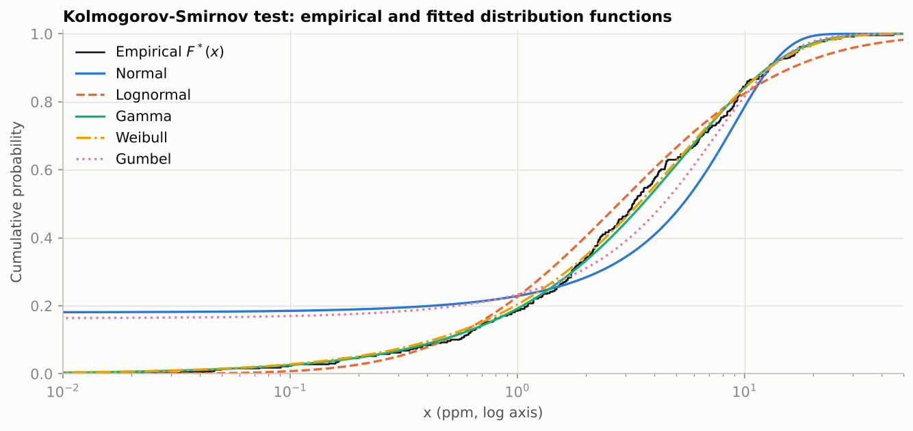
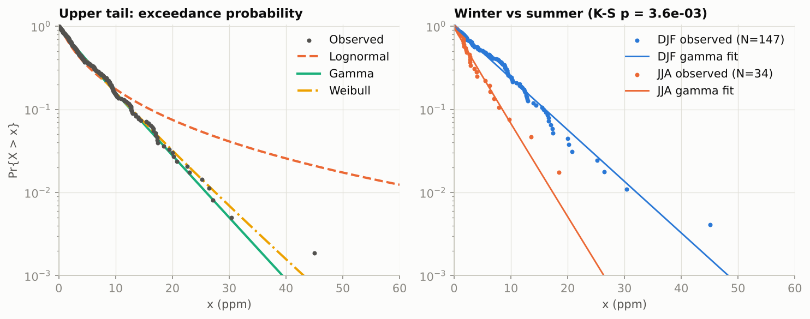

# How Large Are Urban CO₂ Pollution Events? Distribution Fitting at the Boulder Atmospheric Observatory

Statistical analysis of the **size of polluted-air events** in flask CO₂ samples from the 300 m tower of the **Boulder Atmospheric Observatory (BAO)**, Colorado, **August 2007 – July 2016**. The site is about 25 km north of Denver. A day counts as polluted when its CO₂ is more than 5 ppm above the regional background, and the analysed variable is how far it exceeds that threshold.

Five candidate distributions (Normal, Lognormal, Gamma, Weibull, Gumbel) are fitted to this excess. Their fit is assessed with graphical methods (histogram, Q-Q and P-P plots) and with formal tests (χ² and Kolmogorov–Smirnov). The methods follow *Statistical Methods in the Atmospheric Sciences* (Wilks). AIC/BIC model selection, bootstrap uncertainty, tail probabilities and seasonality are added as extensions.



## ❓ Questions
1. What does the distribution of the CO₂ excess on polluted days look like? *(Part A)*
2. Which theoretical distribution describes it best, judged by histogram, Q-Q and P-P plots? *(Parts B–C)*
3. Do the χ² and Kolmogorov–Smirnov tests confirm the graphical assessment? How sensitive are they to the number of classes and to parameters estimated from the data? *(Part D)*
4. What does the best model imply about extreme events and about seasonality? *(Part E)*

## 📊 Data
| | |
|---|---|
| Samples | NOAA GML PFP flask-air CO₂ at BAO (40.05° N, 105.00° W, intake 305 m above ground), 3687 samples, 3414 valid |
| Daily series | C = mean of the valid samples of each day, 2306 sampling days |
| Background | b(t) = linear trend + annual and semi-annual harmonics, fitted iteratively without polluted days (residual > 2σ) |
| Event | Δ = C − b(t) > 5 ppm → 319 polluted days (13.8% of sampling days) |
| Variable | **x = Δ − 5 ppm** on polluted days (N = 319) |

Details and the citation are in [data/README.md](data/README.md).

## 📈 Key findings
- **Shape:** the excess has a reversed-J shape: the mode is in the lowest class, the mean is 5.36 ppm and the median 3.22 ppm. Skewness is 2.30 and the coefficient of variation 1.09, which is close to an exponential distribution (CV = 1, skewness = 2).
- **Best fit: Gamma** (α̂ = 0.906, β̂ = 5.92 ppm, Thom estimator). It is accepted by every test: χ² = 7.80 < 14.07 (m = 10, d.f. = 7) and K–S Δ = 0.049 < 0.052.
- **Weibull** (α̂ = 0.907, β̂ = 5.12 ppm) is equally good. It has the smallest K–S statistic (Δ = 0.038) and the lowest AIC. Its χ² rejection at m = 10 (14.70 vs 14.07) is borderline: it is accepted for m = 6, 8, 12, 15 and 20.
- **Lognormal fails in the tail.** The Q-Q plot shows theoretical quantiles up to 147 ppm against an observed maximum of 45 ppm, and the model predicts Pr{X > 20 ppm} = 0.075 against an observed 0.031. It passes the K–S test only with the textbook critical value (Δ = 0.0757 < 0.0761). With a critical value that accounts for estimated parameters (0.0499, Monte Carlo) it is rejected.
- **Normal and Gumbel** put 18% and 16% of their probability below zero, which is impossible for an excess, and are rejected by all tests.
- **Close to exponential:** the bootstrap 95% interval of the gamma shape is 0.80–1.04, which includes α = 1 (exponential). BIC prefers the one-parameter exponential model. This agrees with extreme-value theory: excesses over a high threshold follow a generalized Pareto distribution, and the exponential is its simplest case.
- **Seasonality:** winter (DJF) events are larger than summer (JJA) events (mean 6.9 vs 3.6 ppm; two-sample K–S p = 0.004), consistent with a shallower and more stable winter boundary layer. The pooled sample is therefore not completely homogeneous.
- **Risk estimate:** combining the event probability (0.138) with the gamma tail gives Pr{Δ > 25 ppm} = 0.0039 per sampling day. The observed value is 0.0043.

| Histogram and fitted densities | Q-Q plots |
|---|---|
|  |  |

| Kolmogorov–Smirnov | Tail and seasonality |
|---|---|
|  |  |

## 🔧 Methods
- **A. Events:** valid samples (QC flag starting with "."), daily means, background curve with iterative 2σ clipping of positive residuals, threshold 5 ppm.
- **B. Fitting:** Normal and Lognormal by moments (of x and ln x); Gamma by the Thom (1958) approximation to maximum likelihood; Weibull by Justus et al. (1978), α = (s/x̄)^−1.086; Gumbel by moments. Histogram superposition N·w·f(x).
- **C. Probability plots:** Cunnane plotting position pᵢ = (i − 0.4)/(N + 0.2); Q-Q plots (F⁻¹(pᵢ), x₍ᵢ₎) and P-P plots (F(x₍ᵢ₎), pᵢ) with their correlation coefficients.
- **D. Tests (α = 0.05):**
  - χ² with m = 10 equal-probability classes (expected count 31.9 per class), d.f. = m − 2 − 1, plus a sensitivity check for m = 6–20.
  - K–S with Δ = max|F(xᵢ) − F\*(xᵢ)|. The critical value is 1.36/√N, plus Monte Carlo critical values that account for parameters estimated from the data (2000 simulations, Lilliefors approach).
- **E. Extensions:** maximum-likelihood AIC/BIC including the exponential model; bootstrap confidence interval of the gamma shape; observed vs fitted exceedance probabilities; seasonal gamma fits and a two-sample K–S test (DJF vs JJA).

## 📁 Repository structure
```
├── data/bao_co2_pfp_flask.csv              flask samples (NOAA GML, BAO)
├── data/README.md                          data description and citation
├── src/bao.py                              loading, daily means, background curve, events
├── src/gof.py                              estimators, probability plots, χ², K–S, AIC/BIC
├── src/plotstyle.py                        shared figure style
├── scripts/01_events.py                    Part A
├── scripts/02_fit_histogram.py             Part B
├── scripts/03_probability_plots.py         Part C
├── scripts/04_goodness_of_fit_tests.py     Part D
├── scripts/05_model_selection_and_risk.py  Part E
├── results/                                output tables (CSV)
└── figures/                                output figures (PNG)
```

## ▶️ How to run
```bash
pip install -r requirements.txt
python scripts/01_events.py
python scripts/02_fit_histogram.py
python scripts/03_probability_plots.py
python scripts/04_goodness_of_fit_tests.py
python scripts/05_model_selection_and_risk.py
```

## ⚠️ Limitations
- The goodness-of-fit tests assume independent observations from one population. Polluted days cluster in time, and the excess depends on the season.
- The 5 ppm threshold and the background curve are analysis choices, so a different threshold changes N and the fitted parameters.
- The flask record has gaps, so "days" are sampling days, not calendar days.
- Wind direction and boundary-layer height, which control the events physically, are not used.

## 📚 References
- Coles, S. (2001). *An Introduction to Statistical Modeling of Extreme Values.* Springer.
- Cunnane, C. (1978). Unbiased plotting positions – a review. *Journal of Hydrology*, 37, 205–222.
- Justus, C. G., Hargraves, W. R., Mikhail, A. and Graber, D. (1978). Methods for estimating wind speed frequency distributions. *Journal of Applied Meteorology*, 17, 350–353.
- Lilliefors, H. W. (1967). On the Kolmogorov–Smirnov test for normality with mean and variance unknown. *JASA*, 62, 399–402.
- Thom, H. C. S. (1958). A note on the gamma distribution. *Monthly Weather Review*, 86, 117–122.
- Wilks, D. S. (2019). *Statistical Methods in the Atmospheric Sciences*, 4th ed. Elsevier.
